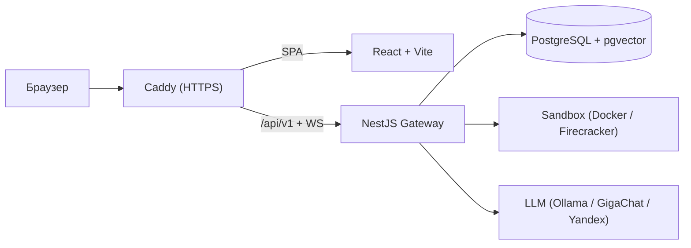

<div align="center">

# SkillWharf

**СкиллВерфь** — российская self-hosted платформа для автономных ИИ-агентов
с долговременной памятью, навыками и встроенной монетизацией.

[](https://github.com/iilmchat/ai-skillwharf/actions/workflows/ci.yml)
[](https://github.com/iilmchat/ai-skillwharf/releases)
[](https://nodejs.org)
[](https://docs.docker.com/compose/)

</div>

## О проекте

SkillWharf разворачивается на своём сервере и не требует внешних облачных сервисов: данные, агенты и биллинг остаются под вашим контролем. Интерфейс поддерживает русский и английский языки (RU/EN), а модели подключаются через OpenAI-совместимый API — локальный Ollama или внешний провайдер.

**Стек:** TypeScript (Node.js 24+) · NestJS · Fastify · LangGraph · PostgreSQL (pgvector) · React · Caddy · Docker.

## Возможности

- **Автономные агенты** — состояние сохраняется, работа продолжается после перезапуска.
- **Три уровня расширяемости** — Tools (действия), Skills (инструкции), Plugins (исполняемый код).
- **Безопасность** — выполнение стороннего кода в изолированной песочнице (Docker, в планах Firecracker).
- **Монетизация** — Pay-per-Call, Freemium и Pay-per-Outcome (Эскроу) с поддержкой ЮKassa.
- **Control Plane** — управление промптами, LLM-роутами и аудитом без перезапуска сервера.
- **AI-Офис** — визуальный слой с Human-in-the-Loop для контроля агентов.
- **RU/EN интерфейс** — переключатель языка в UI, выбор сохраняется в браузере.
- **10 бизнес-треков** — от ПВЗ и HR до Контента и Финансов (в документации).

## Архитектура



## Быстрый старт

### Требования

- Docker 24+ и Docker Compose v2;
- 8 GB RAM (16 GB рекомендуется для локальной LLM);
- свободные порты `8080` (UI), `3001` (API) и `5435` (PostgreSQL).

### Запуск

```bash
git clone https://github.com/iilmchat/ai-skillwharf.git
cd ai-skillwharf
cp .env.example .env
# Отредактируйте .env: пароли, JWT_SECRET, ключи LLM
docker compose up -d --build
```

| Сервис | Адрес |
| --- | --- |
| Веб-интерфейс | <http://localhost:8080> |
| API Gateway | <http://localhost:3001/api/v1> |
| Healthcheck API | <http://localhost:3001/api/v1/health> |

## Документация

Вся проектная документация — в [`docs/`](docs/README.md):

- [Архитектура и ADR](docs/architecture/README.md)
- [Спецификация навыков](docs/ecosystem/Manifest-Specification.md)
- [Биллинг (Ledger, Pay-per-Outcome)](docs/billing/Billing-Flows.md)
- [Безопасность (Threat Model)](docs/security/Threat-Model.md)
- [Эксплуатация (Runbook)](docs/operations/Deployment-Runbook.md)
- [Известные проблемы](docs/KNOWN_ISSUES.md)

## Лицензия

Open Source (Core). См. файл [`LICENSE`](LICENSE).
