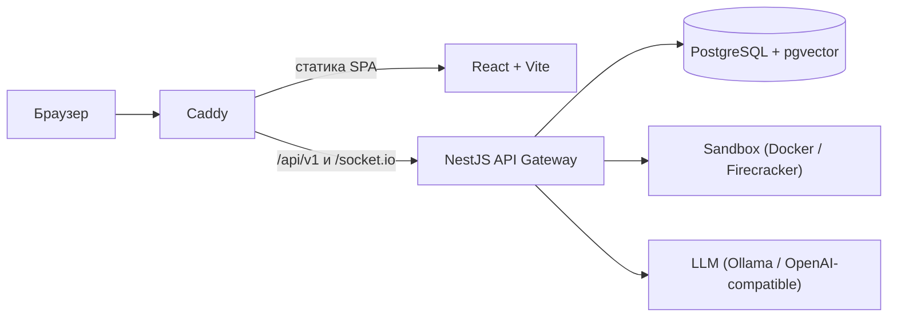

<div align="center">

# SkillWharf

**СкиллВерфь** — российская self-hosted платформа для автономных ИИ-агентов
с долговременной памятью, навыками и встроенной монетизацией.

[](https://github.com/iilmchat/ai-skillwharf/actions/workflows/ci.yml)
[](https://github.com/iilmchat/ai-skillwharf/releases)
[](https://nodejs.org)
[](https://docs.docker.com/compose/)

</div>

## О проекте

SkillWharf разворачивается на своём сервере и не требует внешних облачных
сервисов: данные, агенты и биллинг остаются под вашим контролем. Интерфейс
поддерживает русский и английский языки (RU/EN), а модели подключаются через
OpenAI-совместимый API — локальный Ollama или внешний провайдер.

**Стек:** TypeScript (Node.js 24+) · NestJS · Fastify · LangGraph ·
PostgreSQL (pgvector) · React · Caddy · Docker.

## Возможности

- **Автономные агенты** — состояние сохраняется, работа продолжается после
  перезапуска.
- **Три уровня расширяемости** — Tools (действия), Skills (инструкции),
  Plugins (исполняемый код).
- **Безопасность** — выполнение стороннего кода в изолированной песочнице
  (Docker, в планах Firecracker/gVisor).
- **Монетизация** — Pay-per-Call и подписки, ЮKassa, неизменяемый Ledger
  транзакций.
- **RU/EN интерфейс** — переключатель языка в UI, выбор сохраняется в браузере.
- **Self-hosted** — один `docker compose up` поднимает весь стек.

## Архитектура



| Компонент | Роль |
| --- | --- |
| **Caddy** | Раздаёт статику React и проксирует REST/WebSocket на API |
| **React** | Веб-интерфейс чата, навыков, баланса и настроек |
| **API Gateway** | Аутентификация, агенты LangGraph, биллинг, вызовы навыков |
| **PostgreSQL** | Пользователи, диалоги, кошельки, Ledger (pgvector для памяти) |
| **Sandbox** | Изолированное выполнение кода навыков с лимитами ресурсов |
| **LLM** | Ollama локально или любой OpenAI-совместимый провайдер |

## Быстрый старт

### Требования

- Docker 24+ и Docker Compose v2;
- 8 GB RAM (16 GB рекомендуется для локальной LLM);
- свободные порты `8080` (UI), `3001` (API) и `5435` (PostgreSQL).

### Запуск

```bash
git clone https://github.com/iilmchat/ai-skillwharf.git
cd ai-skillwharf

cp .env.example .env
# Отредактируйте .env: пароли, JWT_SECRET, ключи LLM и биллинга

docker compose up -d --build
```

После старта:

| Сервис | Адрес |
| --- | --- |
| Веб-интерфейс | <http://localhost:8080> |
| API Gateway | <http://localhost:3001/api/v1> |
| Healthcheck API | <http://localhost:3001/api/v1/health> |

Остановить стек: `docker compose down` (вместе с данными БД — `docker compose down -v`).

### Страницы интерфейса

| Маршрут | Назначение |
| --- | --- |
| `/` и `/welcome` | Публичный лендинг, доступен без авторизации |
| `/login` | Вход по email и паролю |
| `/app/chat` | Основной интерфейс чата с агентом (после входа) |
| `/app/skills` | Каталог установленных навыков |
| `/app/store` | Магазин навыков |
| `/app/office` | AI-Офис |

Маршруты `/app/chat`, `/app/skills` и `/app/store` защищены: без
access-токена `ProtectedRoute` перенаправляет на `/login`, а после входа
возвращает на запрошенный адрес. Старые пути `/chat`, `/skills`, `/store`
перенаправляют на `/app/*`, `/office` оставлен алиасом `/app/office` — так
сохранённые ссылки продолжают работать.

Все маршруты обслуживает один SPA-бандл: Caddy отдаёт `index.html` для
любого пути без файла (см. `apps/web/Caddyfile`), поэтому прямые переходы и
перезагрузка страницы работают без дополнительных rewrite-правил.

### Локальная LLM (Ollama)

```bash
docker compose --profile with-llm up -d
docker compose exec ollama ollama pull llama3
```

В `.env` укажите `LLM_BASE_URL=http://ollama:11434/v1`, `LLM_MODEL=llama3` и
перезапустите API: `docker compose up -d api`.

## Production

Для реального домена используйте профиль `production` — Caddy автоматически
получит сертификат Let's Encrypt и включит HTTPS:

```bash
DOMAIN=skillwharf.example.com \
ACME_EMAIL=admin@example.com \
docker compose --profile production up -d --build
```

Перед деплоем замените пароли и секреты, отключите `SANDBOX_ALLOW_NETWORK` и
закройте наружу лишние порты. Полная инструкция — в
[Runbook, раздел 10](docs/operations/Deployment-Runbook.md#10-production-https-с-caddy).

## Разработка

```bash
# Установка зависимостей
pnpm install

# Тесты и сборка
pnpm test
pnpm build:api
pnpm --filter web build

# Линтинг документации
pnpm run lint:docs
```

Структура репозитория:

```text
apps/
  api/              NestJS API Gateway
  web/              React SPA + Caddy
packages/shared/    Общие Zod-схемы и типы
sandbox/            Образ и compose для изолированного выполнения
starter-skills/     Стартовый каталог навыков
deploy/             Production-конфигурация Caddy
docs/               Архитектура, безопасность, биллинг, runbook
```

## Документация

Вся проектная документация — в [`docs/`](docs/README.md):

- [Архитектура и ADR](docs/architecture/README.md)
- [Система расширений](docs/ecosystem/Manifest-Specification.md)
- [Биллинг и транзакции](docs/billing/Billing-Flows.md)
- [Безопасность и Threat Model](docs/security/Threat-Model.md)
- [Эксплуатация и развёртывание](docs/operations/Deployment-Runbook.md)
- [Известные проблемы](docs/KNOWN_ISSUES.md)

## Лицензия

Open Source (Core). См. файл [`LICENSE`](LICENSE).
