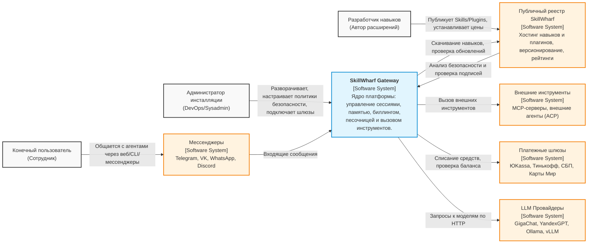

# C4 Level 1: Контекст системы

**Статус:** Черновик

**Дата:** 2026-11-12

## 1. Назначение

Диаграмма показывает систему SkillWharf в масштабе всей экосистемы, ключевых пользователей и внешние системы, с которыми она взаимодействует.

## 2. Диаграмма (Mermaid)

## 3. Описание акторов и внешних систем

### Акторы (Пользователи)

1. **Администратор инсталляции (DevOps/Sysadmin):**
   * **Роль:** Владелец инсталляции (on-premise или облачной).
   * **Действия:** Разворачивает Gateway, настраивает RBAC, подключает платежные адаптеры (BAL), устанавливает политики безопасности (sandbox, лимиты токенов), управляет приватным реестром.
   * **Взаимодействие:** CLI, Web UI админки.

2. **Разработчик навыков (Автор расширений):**
   * **Роль:** Создатель контента для экосистемы.
   * **Действия:** Пишет SKILL.md, разрабатывает JS/TS плагины, публикует их в публичный/приватный реестр, устанавливает модели монетизации (Free, Pay-per-Call).
   * **Взаимодействие:** CLI, Web UI реестра.

3. **Конечный пользователь (Сотрудник):**
   * **Роль:** Потребитель возможностей агентов.
   * **Действия:** Ставит задачи автономным агентам, общается с ними через привычные интерфейсы.
   * **Взаимодействие:** Мессенджеры (Telegram, VK), Web-чат, CLI.

### Внешние системы

1. **LLM Провайдеры:**
   * **Назначение:** Обеспечение работы языковых моделей.
   * **Интеграция:** GigaChat, YandexGPT (российские), Ollama, vLLM (локальные). Взаимодействие через OpenAI-совместимый фасад HTTP API.

2. **Платежные шлюзы:**
   * **Назначение:** Обработка транзакций для монетизации навыков и подписок.
   * **Интеграция:** ЮKassa (основной), СБП, Тинькофф. Использование Billing Abstraction Layer (BAL) для изоляции.

3. **Публичный реестр SkillWharf:**
   * **Назначение:** Централизованное хранилище Skills и Plugins с версионированием, метаданными и рейтингами.
   * **Интеграция:** Gateway обращается к реестру для скачивания обновлений, проверки целостности (checksums) и подписей безопасности.

4. **Мессенджеры:**
   * **Назначение:** Каналы коммуникации конечных пользователей с агентами.
   * **Интеграция:** Webhook-и и API мессенджеров (Telegram Bot API, VK API).

5. **Внешние инструменты (MCP / ACP):**
   * **Назначение:** Расширение возможностей агентов за пределами платформы.
   * **Интеграция:** Model Context Protocol (MCP) для подключения внешних Tool-серверов; Agent Communication Protocol (ACP) для делегирования задач внешним агентам.

## 4. Ключевые архитектурные решения (Связь с ADR)

* Изоляция внешних вызовов через Gateway ([ADR 0001: Выбор паттерна Hub-and-Spoke](ADR/0001-hub-and-spoke.md)).
* Использование абстракций для LLM, памяти и биллинга (ADR 0004, ADR 0005).

## 5. Связанные документы

* [Раздел 1: Архитектура](README.md)
