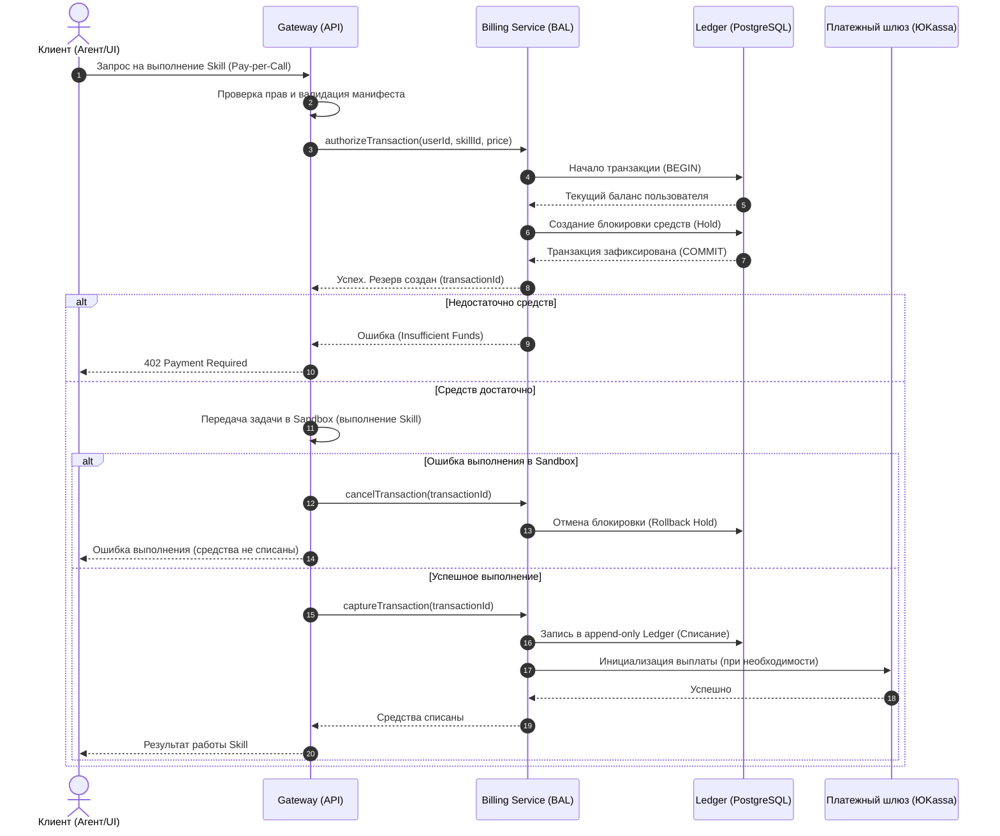

# Схемы взаимодействия биллинга

**Статус:** Утверждено
**Дата:** 2026-11-12

## 1. Сценарий Pay-per-Call (Оплата за вызов)

Этот сценарий описывает процесс списания средств при вызове платного навыка. Ключевая особенность — двухфазная фиксация транзакции (Hold -> Capture), чтобы не списывать деньги, если выполнение навыка в песочнице завершится ошибкой.

### Диаграмма последовательности

## 2. Компоненты и их роли

* **Gateway:** Выступает точкой интеграции. Он не знает, как именно списываются деньги, он лишь дергает абстрактный метод `authorize` перед запуском Sandbox и `capture` после успешного выполнения.
* **Billing Abstraction Layer (BAL):** Оркестратор платежей. Он инкапсулирует логику работы с разными провайдерами (ЮKassa, CloudPayments, Тинькофф) и внутренним кредитным бэкендом (для on-premise).
* **Ledger (Реестр):** Таблица в PostgreSQL с политикой `append-only`. Записи нельзя изменять или удалять, только добавлять новые. Это обеспечивает аудит и соответствие требованиям ФСТЭК.
* **Payment Gateway:** Внешний шлюз (например, ЮKassa). Используется для фактического вывода средств с карты или проведения сплитования (Revenue Share 85/15).
