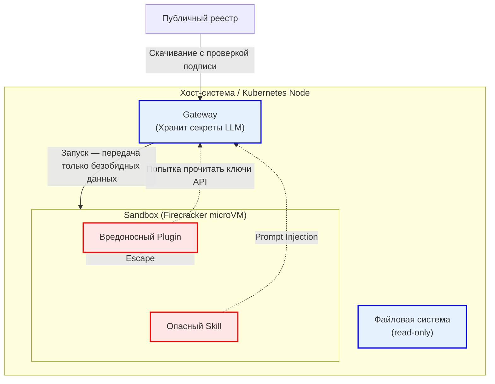

# Threat Model: Система расширений SkillWharf

**Статус:** Утверждено
**Дата:** 2026-11-12
**Методология:** STRIDE

## 1. Контекст и границы анализа

SkillWharf позволяет устанавливать сторонние расширения: **Skills** (декларативные инструкции) и **Plugins** (исполняемый код на JS/TS).
Границы анализа включают: процесс установки из реестра, валидацию манифеста, выполнение кода в Sandbox (Firecracker/gVisor) и взаимодействие с LLM.

## 2. Модель угроз (STRIDE)

| Категория | Угроза (Сценарий атаки) | Меры контроля (Митигация) |
| :--- | :--- | :--- |
| **S**poofing (Подмена) | Злоумышленник публикует плагин под именем известного автора или подменяет популярный навык (Typosquatting) в реестре. | **Криптографические подписи:** Плагины подписываются приватным ключом автора. Gateway проверяет подпись публичным ключом из профиля автора в реестре. |
| **T**ampering (Изменение) | Подмена содержимого `SKILL.md` или исполняемого кода плагина при скачивании (Man-in-the-Middle) или на диске сервера. | **Контроль целостности:** В манифесте обязателен `checksum` (SHA-256). Gateway сверяет хеш перед каждым запуском в Sandbox. |
| **R**epudiation (Отказ от авторства) | Автор вредоносного плагина заявляет, что его аккаунт взломали, или агент отрицает выполнение опасного инструмента. | **Append-only Ledger:** Все действия с расширениями (установка, запуск, сетевые вызовы) пишутся в неизменяемый аудит-лог с привязкой к ID пользователя и сессии. |
| **I**nformation Disclosure (Утечка данных) | Вредоносный плагин пытается прочитать системные промпты, ключи API (LLM) или данные других пользователей из памяти (Memory Backend). | **Изоляция:** Ключи API хранятся только в Gateway и никогда не передаются в Sandbox. Память доступна только через строго типизированный API Gateway, который проверяет права сессии (RBAC). |
| **D**enial of Service (Отказ в обслуживании) | Плагин содержит бесконечный цикл, пытается майнить криптовалюту или исчерпать оперативную память/CPU хоста. | **Лимиты Sandbox:** Firecracker/gVisor ограничивают CPU, RAM и время выполнения (timeout). Сетевой доступ блокируется на уровне iptables, если не запрошено разрешение `network`. |
| **E**levation of Privilege (Повышение привилегий) | Эксплойт в плагине позволяет вырваться из песочницы (Sandbox Escape) и получить доступ к хосту (Root) или сети кластера K8s. | **Аппаратная изоляция:** Использование Firecracker (KVM) как основного бэкенда. Запуск с правами non-root, read-only файловая система (кроме `/tmp`), seccomp-фильтры, запрет `no-new-privileges`. |

## 3. Диаграмма поверхности атаки

## 4. Требования к безопасности (Security Controls)

1. **Sandbox Provider:** Основной бэкенд — Firecracker. Fallback — gVisor. Обычные Docker-контейнеры без дополнительной изоляции (seccomp) **не допускаются** для сторонних плагинов.
2. **Статический анализ:** При публикации в реестр код проходит проверку на наличие вызовов `child_process`, `eval`, `fs` (без объявленных прав).
3. **Разрешения (Permissions):** Плагин должен явно запросить доступ к сети (`network`) или файлам (`filesystem`) в манифесте. Администратор инсталляции может запретить установку таких плагинов глобально.
4. **Безопасность LLM:** Инструкции в Skills не могут отменять системные промпты (защита от Prompt Injection на уровне `AiPromptComposer`).
