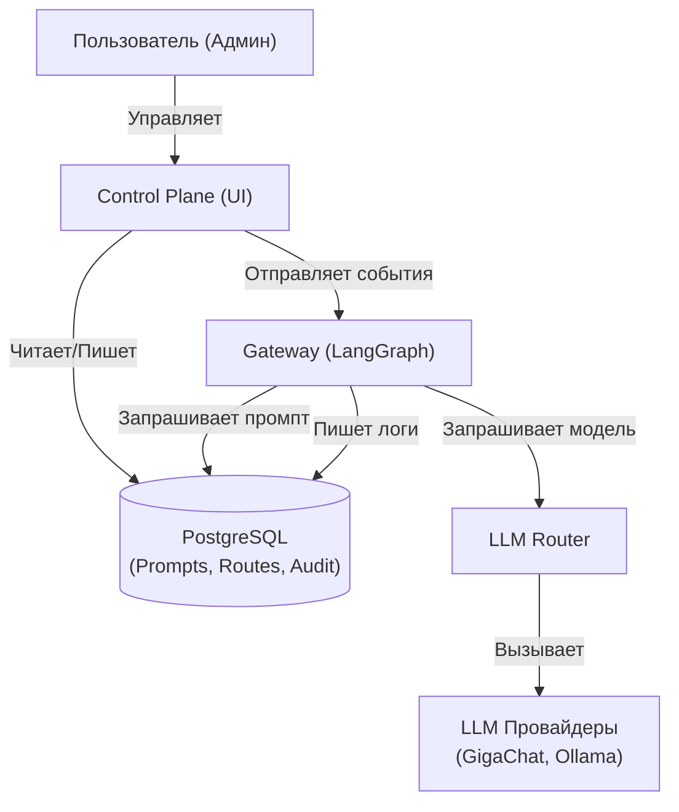

# Спецификация: Пункт Управления Верфью (Wharf Control Plane)

**Статус:** Утверждено
**Дата:** 2026-11-13

## 1. Общая архитектура

Пульт управления (Control Plane) — это централизованный слой управления, который объединяет визуальный контроль над офисом, жизненный цикл промптов, маршрутизацию LLM и финансовую аналитику.

## 2. Блоки управления

### Блок 1: Управление визуальным офисом

- Интерактивные статус-карты (Agent Identity Cards): heartbeat, текущая модель, trust score, токены.
- Kanban жизненного цикла задач (Inbox → In Progress → Review → Done).
- Карта взаимодействий (Node Graph): граф связей между агентами.
- Управление «Дверями» (Approval Gates): панель для Human-in-the-Loop.

### Блок 2: Управление промптами (Prompt Lifecycle Management)

- Внешнее хранение (БД или Git).
- Версионирование и откат (Versioning & Rollback).
- Среды и продвижение (Environment Tagging): dev, staging, prod.
- A/B-тестирование на реальном трафике.
- Шаблонизация (сборка из блоков, переменные).

### Блок 3: Настройки LLM и маршрутизация (LLM Router)

- Правила маршрутизации (Routing Rules): classification → DeepSeek, complex_reasoning → GigaChat-Pro.
- Fallback-цепочки: переключение при сбое (429, 5xx) на Backup-провайдера.
- Бюджетные «предохранители» (Budget Guardrails): лимиты на агента/отдел/клиента (HTTP 402).
- Управление ключами и квотами.

### Блок 4: Отслеживание балансов и качества (Observability)

- Cost (Затраты): общий расход с разбивкой по модели, агенту, клиенту.
- Latency (Задержка): p50, p95, p99, Time-to-First-Token (TTFT).
- Quality (Качество): faithfulness, user feedback 👍/👎, дрейф.
- Volume (Объем): количество запросов, токенов, активных сессий.

### Блок 5: Роли, доступ и аудит (Governance)

- Роли: Owner (полный доступ), Admin (без платежных ключей), Operator (одобрение HITL), Viewer (чтение).
- Аудит-лог (Audit Trail): логирование всех действий (кто, что, когда, зачем).

## 3. Схема взаимодействия (Mermaid)

