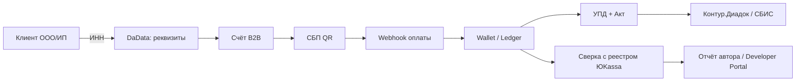
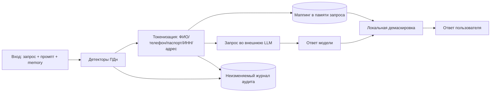
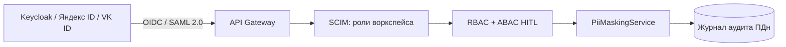
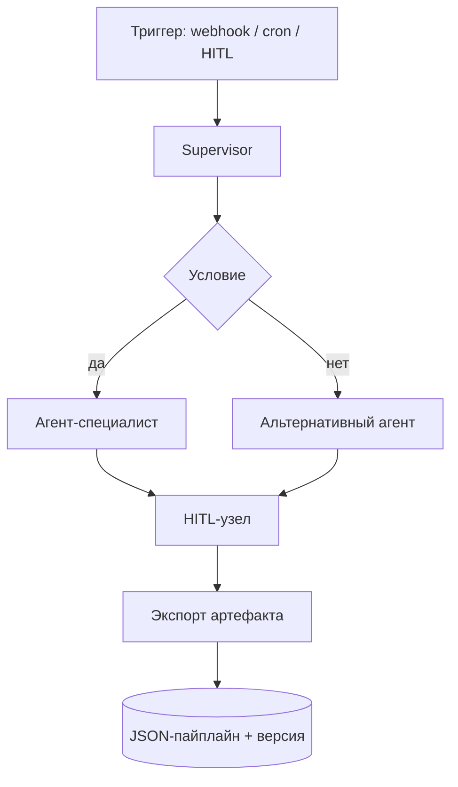
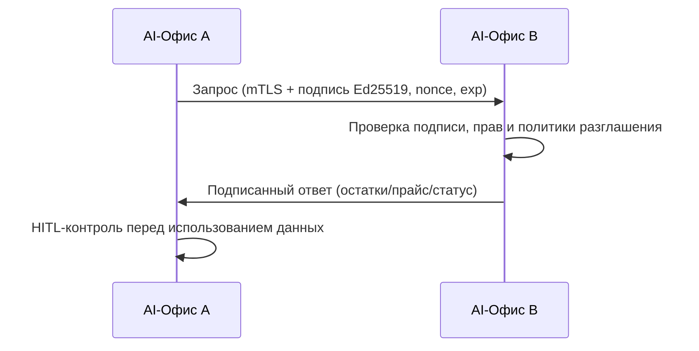

# Enterprise V4 Blueprint — целевая архитектура поколения `v4.0.0`

Документ описывает целевое состояние ключевых подсистем платформы после
релиза `v4.0.0` (Этап 15 дорожной карты
[ROADMAP-V4.md](../development/ROADMAP-V4.md)). Базовая точка — `v3.0.0`;
принципы из [ADR 0002](ADR/0002-tech-stack.md) сохраняются: self-hosted
контур, минимальные внешние зависимости, приоритет российских провайдеров.

---

## 1. Контур B2B-биллинга РФ

### 1.1. Состав и потоки

### 1.2. Компоненты

| Компонент | Ответственность | Спринт |
| --- | --- | --- |
| DaData Adapter | Автозаполнение реквизитов по ИНН, валидация ООО/ИП | B2B-46.1 |
| SBP Gateway | QR-код, привязка платежа к счёту, подтверждение зачисления | B2B-46.2 |
| Invoice Service | Жизненный цикл счёта: created / sent / paid / overdue | B2B-46.1 |
| Closing Documents | Генерация УПД и Акта после оплаты | B2B-46.3 |
| EDO Connector | Отправка в Диадок/СБИС, трекинг статуса подписания | B2B-46.3 |
| Reconciliation | Сверка BAL/Ledger с реестром ЮKassa, расхождения | B2B-46.4 |
| Author Reports | Выгрузка начислений и выплат в Developer Portal | B2B-46.4 |

### 1.3. Инварианты

* Счёт не переходит в `paid` без подтверждённого webhook СБП.
* Закрывающие документы создаются **один раз** по `idempotencyKey` счёта.
* Любое расхождение при сверке фиксируется в Ledger и попадает в отчёт автора.
* Выплата автору и комиссия платформы остаются в одной транзакции c Outbox.

---

## 2. Безопасный шлюз 152-ФЗ

### 2.1. Пайплайн обезличивания и аудит

### 2.2. Принципы

* Маппинг `токен -> значение` живёт только в памяти одного запроса и не
  попадает в БД, Redis, логи или trace.
* Журнал аудита хранит **факт** обезличивания: тип ПДн, хэш значения, время,
  `userId`, `conversationId`, номер правила. Для проверок 152-ФЗ этого
  достаточно без раскрытия самих данных.
* Журнал дополняется только (`append-only`); попытка UPDATE/DELETE блокируется
  триггером, как это уже сделано для `LedgerEntry`.
* Expanded detectors (SEC-49.3) добавляют ФИО и адреса к существующим
  телефонам, email, СНИЛС, паспортам и ИНН.

### 2.3. Интеграция с SSO

---

## 3. Visual Workflow DAG Engine и протокол A2A

### 3.1. Исполнение графа

### 3.2. Agent-to-Agent Protocol

### 3.3. Требования протокола

* Каждый A2A-запрос подписывается Ed25519 и содержит `nonce`, `exp` и `aud`,
  что исключает повтор и подмену получателя.
* Транспорт — mutual TLS между контрагентами; сертификаты управляются через
  корпоративный KMS/Vault.
* Политика разглашения определяет, какие поля (остатки, цены, сроки поставки)
  можно отдавать конкретному контрагенту.
* Исходящий запрос проходит HITL, если включена соответствующая политика
  воркспейса; результат и решение пишутся в журнал аудита.

---

## 4. Связь с дорожной картой

| Подсистема | Задачи | Версия |
| --- | --- | --- |
| B2B-биллинг РФ | B2B-46.1–46.4, закрытие OUTBOX-33.3 и DEVPORTAL-36.3 | `v3.1.0` |
| 152-ФЗ шлюз | SEC-49.3, VOICE-48.1–48.3 | `v3.2.0` – `v3.3.0` |
| Workflow Studio | FLOW-51.1–51.3, закрытие BUILDER-35.2 | `v4.0.0` |
| A2A Protocol | A2A-52.1–52.3 | `v4.0.0` |

Реализация пограничных сценариев и миграций описывается в спринтах
[ROADMAP-V4.md](../development/ROADMAP-V4.md); текущий контракт интеграций —
в [MCP-ERP-Connectors.md](MCP-ERP-Connectors.md).
