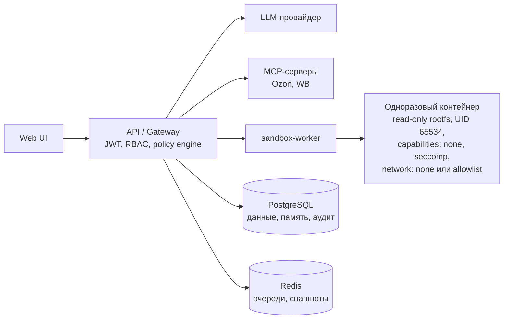

# Безопасность SkillWharf

**Для кого:** администраторы инсталляций, служба безопасности, юристы и
руководители, которым нужно понять, как платформа защищает данные и код.

**Обновлено:** 2026-11-14 (Sprint 20).

Этот раздел — точка входа. Он отвечает на три практических вопроса: кто и как
получает доступ, что происходит с персональными данными (152-ФЗ) и как
изолируется недоверенный код. Детальные модели угроз и архитектурные решения —
в отдельных документах, ссылки ниже.

## 1. Документы раздела и смежные материалы

| Документ | О чём |
| --- | --- |
| [Threat Model (STRIDE)](Threat-Model.md) | Модель угроз для навыков и плагинов, меры контроля, поверхность атаки |
| [ADR 0004: MCP-коннекторы и Agent Gateway](../architecture/ADR/0004-mcp-connectors-and-security-gateway.md) | Policy engine, FQDN-aware egress, `mcp_endpoint` из манифеста |
| [ADR 0005: Изоляция sandbox-worker](../architecture/ADR/0005-isolated-sandbox-worker.md) | Почему исполнение кода вынесено из API и что это даёт |
| [ADR 0003: AI-Офис как плагин](../architecture/ADR/0003-ai-office-plugin.md) | Опциональность визуального слоя |
| [Спецификация Skill Manifest](../ecosystem/Manifest-Specification.md) | `permissions`, `egress_allowlist`, `mcp_endpoint`, `requiresApproval` |
| [Runbook развёртывания](../operations/Deployment-Runbook.md) | Секреты, бэкапы, мониторинг, ротация |
| [Известные проблемы](../KNOWN_ISSUES.md) | Остаточные риски с идентификаторами KI |
| [Биллинг: Cost Guardrails](../billing/Cost-Guardrails-Specification.md) | Дневные лимиты, резервирование и списание |
| [Pay-per-Outcome](../billing/Pay-Per-Outcome-Specification.md) | Эскроу: hold → capture/cancel |

## 2. Модель защиты за минуту

Защита построена по принципу «эшелонированной обороны»: ни один слой не
считается достаточным сам по себе.

1. **Доступ** — вход по email и паролю, короткоживущий токен, роли, лимиты
   частоты запросов.
2. **Секреты** — ключи хранятся на сервере, шифруются и никогда не попадают в
   песочницу или в журналы.
3. **Проверка вызовов** — каждый вызов инструмента проходит декларативную
   политику: схема аргументов, разрешения навыка, роли, контроль утечек.
4. **Изоляция кода** — недоверенный код исполняет отдельный сервис
   `sandbox-worker` в одноразовом контейнере без сети (по умолчанию).
5. **Ограничение сети** — исходящие соединения только к доменам из манифеста
   навыка, всё остальное блокируется (deny by default).
6. **Подтверждение человеком (HITL)** — рискованные и платные действия
   выполняются только после явного «да».
7. **Аудит и наблюдаемость** — изменения Control Plane и блокировки политики
   пишутся в журнал, ошибки — в трейсы.

## 3. Идентификация и доступ

| Контроль | Как реализовано |
| --- | --- |
| Пароли | Хеширование Argon2, открытый пароль не хранится |
| Access-токен | JWT, срок жизни 15 минут, хранится только в памяти браузера |
| Refresh-токен | Одноразовый, при обновлении сессии ротируется; в БД хранится только его хеш |
| Роли | `user` — обычный пользователь; `admin` и `owner` — управление платформой |
| Регистрация | В интерфейсе самостоятельной регистрации нет: учётные записи выдаёт администратор. В API маршрут `POST /auth/register` открыт и ограничен 10 попытками в час — для публичного контура его нужно закрыть на reverse proxy или перевести под роль администратора |
| Защита от подбора | Вход — 5 попыток в минуту, регистрация — 10 в час, общий лимит API — 1000 запросов в минуту |
| Административные маршруты | Установка навыков, промпты, LLM-маршруты, ручное пополнение и списание — только для роли `admin` |

После истечения access-токена сессия восстанавливается по refresh-токену; если
refresh-токен отозван или истёк, пользователь входит заново.

## 4. Секреты и ключи

| Что | Где хранится | Как защищено |
| --- | --- | --- |
| Пароли пользователей | PostgreSQL | Argon2-хеш |
| Refresh-токены | PostgreSQL | Хеш, ротация при каждом обновлении |
| Ключи интеграций (Telegram, Google, Ozon, WB, Midjourney) | PostgreSQL | AES-256-GCM, конверт `v1:<iv>:<tag>:<ciphertext>`, ключ `TOKEN_ENCRYPTION_KEY` |
| Ключи LLM-провайдеров, БД, ЮKassa, поиска Tavily | Переменные окружения | Не попадают в контейнеры навыков и в ответы API |
| Секреты для навыков в песочнице | Переменные контейнера | Только из allowlist (`TAVILY_API_KEY`, `GITHUB_TOKEN`), остальные не передаются |

Правила, которые соблюдает платформа:

- ключи интеграций не показываются после сохранения — только статус и
  идентификатор подключения;
- LLM-ключи и доступ к БД не передаются в песочницу ни при каких вызовах;
- ошибки провайдеров не содержат значений ключей; в Sentry маскируются строки
  вида `token=…`, `Authorization: Bearer …` и JWT;
- в браузере не хранится ничего, кроме refresh-токена и настроек интерфейса
  (язык, тема) — access-токен живёт только в памяти вкладки.

Ограничение: ротация `TOKEN_ENCRYPTION_KEY` без потери доступа к сохранённым
интеграциям пока не реализована — KI-053.

## 5. Проверка вызовов инструментов (policy engine)

Перед каждым вызовом инструмента API проверяет его декларативно, а не по
регулярным выражениям:

- **Схема аргументов** — strict Zod-схема для каждого инструмента: лишние поля
  отклоняются, типы проверяются.
- **Разрешения навыка** — инструмент доступен, только если навык объявил
  нужное разрешение (`network`, `filesystem`, `shell`, `secrets`,
  `hardware`).
- **Анализ shell-команд** — структура команды разбирается, бинарники
  проверяются по allowlist; опасные конструкции блокируются.
- **Контроль утечек (taint)** — значения из недоверенных источников (веб,
  документы, ответы MCP) помечаются и не могут быть отправлены в каналы
  эксфильтрации; в поиске маскируются.
- **Роли и контекст** — часть инструментов доступна только администратору или
  только в разрешённом контексте.
- **Аудит блокировок** — каждая блокировка пишется в журнал с привязкой к
  пользователю и сущности.

Ограничение: анализ shell-команд — эвристика, а не полный POSIX-парсер; это
слой defense-in-depth, а не единственная защита (KI-029).

## 6. Изоляция кода: `sandbox-worker`

Ключевое архитектурное решение (ADR 0005): API **не имеет** доступа к Docker
Socket. Компрометация API не даёт доступа к хосту — исполнение кода вынесено в
отдельный сервис, который принимает только код и лимиты.

| Контроль | Значение по умолчанию |
| --- | --- |
| Файловая система | Read-only rootfs; запись только в `/tmp` (tmpfs) |
| Пользователь | 65534 (nobody), без привилегий |
| Capabilities | Все сняты (`CapDrop: ALL`) |
| Повышение привилегий | Запрещено (`no-new-privileges`) |
| Память | 128 МБ |
| CPU | 0.5 ядра |
| Время выполнения | 10 секунд, затем контейнер уничтожается |
| Сеть | `none` по умолчанию; bridge только при egress-allowlist |
| Жизненный цикл | Одноразовый контейнер на каждый запуск |

### 6.1. Seccomp

В staging и production применяется собственный default-deny профиль
`sandbox/seccomp-profile.json`:

- `defaultAction: SCMP_ACT_ERRNO` — любой неразрешённый системный вызов
  возвращает ошибку;
- архитектура — `x86_64`;
- явно запрещены опасные вызовы: `ptrace`, `mount`, `unshare`, `bpf`,
  `keyctl`, `perf_event_open`, `kexec_*`, `reboot`, `swapon/swapoff`,
  `init_module`, `delete_module`, `pivot_root`, `chroot`, `personality`,
  `userfaultfd` и другие;
- `clone` разрешён только без namespace-флагов, `clone3` возвращает `ENOSYS`
  для безопасного fallback.

Ограничения: профиль рассчитан на `linux/amd64`; при смене профиля требуется
перезапуск worker (KI-026). Без переменной `SANDBOX_SECCOMP_PROFILE` worker
работает с профилем Docker по умолчанию — так можно только в локальной
разработке; в staging переменная обязательна.

### 6.2. Ограничение сети (egress-allowlist)

Сеть в песочнице запрещена по умолчанию. Разрешение задаётся в манифесте
навыка полем `egress_allowlist`:

- только точные FQDN в нижнем регистре: без схемы, порта, пути и wildcard;
- не более 50 доменов;
- FQDN резолвятся в IP на старте, правила применяются через iptables внутри
  сетевого namespace контейнера;
- DNS доступен только процессу настройки; код под UID 65534 DNS не имеет —
  это защита от DNS-туннелей;
- глобальные флаги вида `SANDBOX_ALLOW_NETWORK` сеть не включают: они
  вычищаются и на план не влияют.

Остаточные риски зафиксированы в KI-028 и KI-042: нет фильтрации по SNI/Host
(разрешённый IP можно использовать с любым именем), возможен DNS rebinding,
задержка между резолвом и использованием адреса, `ExtraHosts` работает только
для IPv4. Сетевые политики уровня кластера (NetworkPolicy) пока не заменяют
прикладной allowlist — KI-052.

### 6.3. Что изоляция не обещает

- Текущий уровень — контейнер + seccomp, а не микровиртуализация. Firecracker
  и gVisor заявлены в roadmap (ADR 0002) и пока не включены.
- Песочница защищает хост от кода навыка, но не от вредоносного контента в
  промпте: от prompt injection защищают policy engine, ограничение инструментов
  и HITL.
- Если администратор включил навык с опасными правами, платформа выполнит его
  в рамках политики: решение о доверии навыку остаётся за администратором.

## 7. Подтверждение человеком (HITL) и деньги

- Навыки с `requiresApproval: true` останавливают агента перед действием.
- Срок ожидания — 24 часа (`HITL_APPROVAL_TTL_HOURS`), затем ожидание
  закрывается, а резерв средств снимается.
- Pay-per-Outcome работает по схеме эскроу: при старте средства
  замораживаются (hold), после подтверждения списываются (capture), при
  отклонении или истечении возвращаются (cancel).
- Для запуска задачи на балансе должно быть не меньше 0,50 ₽.
- Дневной лимит токенов защищает бюджет: токены резервируются до вызова
  модели и сверяются после ответа; параллельные запросы не могут превысить
  лимит.
- Платёж ЮKassa создаётся на стороне сервера; вебхук не считается доверенным —
  статус платежа перепроверяется запросом к ЮKassa, зачисление идемпотентно.
  Данные карт платформа не получает и не хранит.

## 8. Персональные данные и 152-ФЗ

### 8.1. Кто оператор

Оператор персональных данных — организация, которая развернула платформу
(владелец инсталляции). SkillWharf предоставляет технические средства защиты
и описывает их в этом разделе; уведомление в Роскомнадзор, согласия
сотрудников и договорная база остаются зоной ответственности оператора.

### 8.2. Какие данные хранятся

| Категория | Состав | Где хранится | Зачем |
| --- | --- | --- | --- |
| Учётная запись | Email, хеш пароля, роль, дневной лимит токенов | PostgreSQL | Вход и права |
| Сессии | Хеш refresh-токена, срок действия | PostgreSQL | Продление сессии |
| Диалоги | Тексты задач и ответов, названия диалогов, связь с пользователем | PostgreSQL | История работы агента |
| Долговременная память | Фрагменты текста до 2 000 символов и их векторные представления (pgvector) | PostgreSQL | Поиск по смыслу между диалогами |
| Биллинг | Кошелёк, баланс, проводки Ledger, идентификаторы платежей | PostgreSQL | Расчёты и история операций |
| Ключи интеграций | Шифротекст ключей Telegram, Google, Ozon, WB, Midjourney | PostgreSQL | Работа интеграций |
| Ожидания HITL | Диалог, причина, список инструментов, срок | PostgreSQL | Подтверждения |
| Состояние выполнения | Чекпоинты задач агента, до 30 дней | PostgreSQL | Продолжение после сбоя |
| Аудит | Кто, что и когда изменил в Control Plane; блокировки политики | PostgreSQL | Разбор инцидентов |
| Финансовые снапшоты | Результаты расчётов финансовых навыков | Redis, TTL 7 дней | Быстрый дашборд |
| Журналы и трейсы | Технические события, ошибки | stdout, Sentry при включении | Диагностика |

**Не хранится:** загруженные документы (разбираются в памяти и не
сохраняются), пароли в открытом виде, ключи в открытом виде, данные банковских
карт (их обрабатывает ЮKassa).

### 8.3. Передача третьим сторонам

| Получатель | Что получает | Комментарий |
| --- | --- | --- |
| LLM-провайдер | Текст задачи и контекст диалога | YandexGPT и GigaChat — в РФ; локальные модели (LM Studio, Ollama) — без выхода из контура |
| ЮKassa | Сумма, идентификатор платежа | Платёжные данные обрабатывает провайдер |
| Telegram | Текст исходящих сообщений | По инициативе пользователя или агента |
| Google | Данные таблиц, документов, календаря | По OAuth-доступу пользователя |
| Ozon / Wildberries | Запросы к Seller API с ключами пользователя | По инициативе пользователя |
| TTAPI | Промпт генерации изображения | Неофициальный API Midjourney |
| Smart Document Engine / Tavily | Изображение скана / поисковый запрос | Если навык использует соответствующий сервис |

Важно для 152-ФЗ: если используется зарубежный LLM-провайдер (например,
OpenAI-совместимый API за пределами РФ), передача промптов является
трансграничной. Для инсталляций, где это критично, выбирайте YandexGPT,
GigaChat или локальные модели — тогда данные не покидают контур.

### 8.4. Кнопка «Забыть меня»

Кнопка находится в **Настройки → Долговременная память**. Она вызывает
`DELETE /api/v1/chat/memory` и удаляет всю долговременную память пользователя:

- строки `MemoryChunk` с текстом фрагментов;
- векторные представления (embeddings) в pgvector — удаляются вместе со
  строкой, поэтому «поиск по смыслу» больше не находит эти фрагменты;
- связь фрагментов с пользователем.

Действие необратимо и не требует подтверждения администратора. Ответ API
содержит число удалённых фрагментов.

Что при этом **не** удаляется:

- диалоги и сообщения (они относятся к истории работы, а не к памяти);
- проводки и баланс (финансовая отчётность);
- журнал аудита;
- подключённые интеграции и ключи — их отзывают отдельно в настройках.

Для полного удаления учётной записи и связанных записей обратитесь к
администратору: самообслуживания пока нет, удаление выполняется по регламенту
инсталляции. Помните, что копии могут оставаться в резервных бэкапах до
истечения срока их хранения (см. п. 8.5).

### 8.5. Сроки хранения и резервные копии

| Данные | Срок |
| --- | --- |
| Ожидания HITL | До 24 часов или до решения |
| Чекпоинты выполнения | 30 дней (настраивается `CHECKPOINT_RETENTION_DAYS`) |
| Финансовые снапшоты | 7 дней (настраивается `FINANCE_SNAPSHOT_TTL_SECONDS`) |
| Диалоги, память, биллинг, аудит | До удаления пользователем или оператором |
| Резервные копии БД | По политике инсталляции и сроку хранения копий |

Резервные копии снимаются `pg_dump`, offsite-копии выгружаются в S3-совместимое
хранилище с retention. Удаление из бэкапов не мгновенное: запись исчезает по
истечении срока хранения копий. Шифрование и object-lock для offsite-копий
настраиваются инфраструктурой — типовое решение их не включает (KI-035).

### 8.6. Права субъекта данных

| Право | Как реализовано |
| --- | --- |
| Знать, какие данные хранятся | Этот раздел и просмотр памяти в настройках |
| Получить доступ к своим данным | Просмотр диалогов и памяти; выгрузка через администратора |
| Удалить память | Кнопка «Забыть меня» |
| Отозвать доступ интеграций | «Отключить»/«Отозвать доступ» в настройках интеграций |
| Удалить учётную запись | Обращение к администратору платформы |

## 9. Аудит и наблюдаемость

- **AuditLog** хранит изменения Control Plane: кто, что, когда, с какими
  метаданными; записи привязаны к пользователю и сущности.
- **Блокировки policy engine** попадают в журнал, чтобы можно было разобрать
  инцидент: какой инструмент, какие аргументы, какое правило сработало.
- **Трейсы OTel** фиксируют вызовы LLM и инструментов; сейчас коллектор пишет
  в stdout без долговременного хранилища и сэмплирования (KI-038).
- **Sentry** подключается при заданном DSN и только для ошибок бэкенда; PII
  фильтруется по регулярным выражениям (KI-039).
- Уведомления об ожидающих подтверждениях пока пишутся только структурным
  логом — email/push нет (KI-047).

## 10. Остаточные риски

| Риск | Где описан |
| --- | --- |
| Публичный маршрут регистрации в API: любой, кто дотянулся до `/api/v1/auth/register`, получает учётную запись с дневным лимитом токенов | Раздел 3 и чек-лист п. 9 |
| Seccomp-профиль только для linux/amd64, применяется после перезапуска worker | KI-026 |
| Egress без фильтрации SNI/Host, DNS rebinding, IPv4-only ExtraHosts | KI-028, KI-042 |
| Shell-анализатор — эвристика | KI-029 |
| Offsite-бэкапы без object-lock и KMS-шифрования | KI-035, KI-036 |
| Трейсы и Sentry без долговременного хранилища и алертинга | KI-038, KI-039 |
| Внутренние вызовы API/worker защищены общим токеном | KI-045 |
| Telegram-вебхук: один системный бот, нет replay-защиты | KI-051, KI-056 |
| Прикладной egress вместо NetworkPolicy | KI-052 |
| Ротация `TOKEN_ENCRYPTION_KEY` и KMS | KI-053 |
| Не отзывается Google refresh-token при отключении | KI-054 |
| Ключи Ozon/WB не доходят до MCP-контейнеров per-user | KI-064 |
| OCR Smart Document Engine: контракт вендора не подтверждён | KI-068 |
| Собственный PDF-парсер: шифрование, редкие фильтры, CID-шрифты | KI-069 |

## 11. Чек-лист администратора

1. Задайте независимые значения `TOKEN_ENCRYPTION_KEY`, `JWT_SECRET` и
   токенов внутренних сервисов; не переиспользуйте dev-значения.
2. В staging и production включите `SANDBOX_SECCOMP_PROFILE` — без профиля
   песочница использует настройки Docker по умолчанию.
3. Ограничьте `API_OUTBOUND_ALLOWLIST` и `LLM_WORKER_OUTBOUND_ALLOWLIST`
   только нужными доменами.
4. Настройте резервное копирование (локально + offsite) и проверьте
   restore-drill по Runbook.
5. Закройте мониторинг аутентификацией; смените статические креды (KI-018).
6. Проверьте, что включённые навыки не запрашивают лишних разрешений, а
   `egress_allowlist` соответствует задаче.
7. Установите разумные `HITL_APPROVAL_TTL_HOURS`, `CHECKPOINT_RETENTION_DAYS` и
   дневные лимиты токенов.
8. Определите срок хранения диалогов и порядок удаления учётных записей —
   это ваша зона ответственности как оператора ПДн.
9. Если учётные записи выдаёт администратор, закройте `POST /auth/register` на
   reverse proxy или переведите маршрут под роль администратора.
